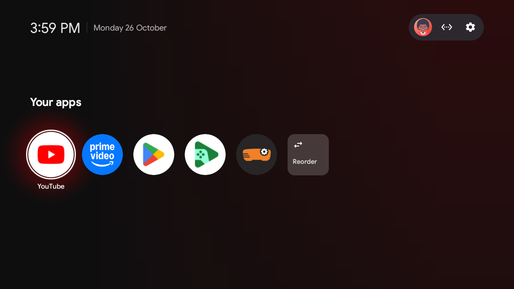
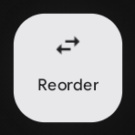

# ElvanTV-Home

> An ultra-fast, ad-free reference launcher for Android TV and Google TV with authentic Google TV UI/UX and zero bloat.  
> Maintained by **Elvan Parthasarathy** ([@ElvanParthasarathy](https://github.com/ElvanParthasarathy)).

---



---

## Highlights

* **Authentic Google TV Experience:**
  * **Circular App Cards:** Pixel-perfect circular app icons normalized across system and sideloaded apps.
  * **Dwelling Focus Ring:** Smooth white circular focus ring that gently breathes when dwelling on an app.
  * **Luminous Ambient Halo:** Rich, color-matched ambient halo that hugs the active card and smoothly transitions between brand colors.
  * **Asymmetrical Living Atmosphere:** Right-heavy background wash that casts cinematic living-room lighting across your screen.
  * **Translucent Reorder Squircle:** Frosted squircle action tile (`#2EFFFFFF` with `22dp` curved corners) with internal arrows and typography, allowing background ambient light to pass right through.
  * **Interactive Reorder Mode:** Native "Arrange your apps" screen with smooth tile sliding animations, indicator arrows, and centered "Done" pill button.

| Focused Ambient Halo | Translucent Reorder Squircle |
| :---: | :---: |
|  |  |

* **Zero Bloat, Zero Telemetry:**
  * **No Network Permission:** The launcher does not request `android.permission.INTERNET`. Zero network calls, zero tracking, zero background analytics.
  * **No Ads or Recommendations:** No sponsored rows, banner carousels, or unskippable promotional tiles.
  * **Ultra-Lightweight:** Written in clean, lean plain Java and AndroidX with **zero external libraries**. Memory footprint is under 15 MB RAM, running fluidly even on entry-level 1 GB RAM smart TVs.

---

## Quick Start

### 1. Build the APK from Source
Ensure you have JDK 17 and the Android SDK installed:

```bash
cd launcher
./gradlew assembleRelease
```
*(On Windows: `gradlew.bat assembleRelease`)*

The compiled APK will be created at:  
`launcher/app/build/outputs/apk/release/app-release.apk`

### 2. Install onto Your TV over ADB
Connect your TV via Wi-Fi ADB (e.g. `adb connect <tv-ip>:5555`) or USB:

```bash
adb install -r launcher/app/build/outputs/apk/release/app-release.apk
```

### 3. Set as Default Home
Launch the app and grant Home activity:

```bash
adb shell am start -n com.elvan.tvhome/.MainActivity
adb shell cmd package set-home-activity com.elvan.tvhome/.MainActivity
```

---

## TV Debloating Suite

This repository includes battle-tested shell and PowerShell tools to debloat ad-heavy stock launchers on Google TV, TCL, Xiaomi, Sony, and other Android TV devices over ADB without root.

### Core Safety Rules
1. **Disable, Never Uninstall:** We use `pm disable-user --user 0`. Nothing is permanently deleted; every change can be reversed anytime.
2. **Back Up First:** Always run a full backup before changing anything:
   ```bash
   tools/backup.sh
   ```
3. **One-Line Restore:**
   ```bash
   tools/restore.sh backup/debloat-applied.txt
   ```
   *(Or on Windows: `powershell -ExecutionPolicy Bypass -File tools\restore.ps1 backup\debloat-applied.txt`)*

---

## Customization

### Changing Dock Apps & Settings
Edit `launcher/app/src/main/res/values/config.xml` before building:
```xml
<string-array name="dock_apps">
    <item>com.google.android.youtube.tv</item>
    <item>com.netflix.ninja</item>
    <item>com.amazon.amazonvideo.livingroom</item>
</string-array>
```

### Applying Themes
Push custom themes and wallpapers live over ADB:
```bash
tools/theme.sh themes/default
```

---

## Supported Devices

Tested and confirmed working on a wide range of hardware platforms:
* **TCL Smart TVs** (MediaTek MT9221 / MT5867 / Realtek)
* **Xiaomi Mi TV & TV Stick** (Amlogic S805Y / S905 series)
* **Chromecast with Google TV** (HD & 4K)
* **Sony BRAVIA** (Android TV 9 / 10 / Google TV)
* Any Android TV running Android 8.0 (Oreo / API 26) through Android 14.

---

## Credits & License

* **License:** [MIT License](LICENSE)
* **Author & Maintainer:** Elvan Parthasarathy ([@ElvanParthasarathy](https://github.com/ElvanParthasarathy))
* **Third-party:** the Outfit typeface ([SIL Open Font License 1.1](launcher/FONT-LICENSE-OFL.txt)); copyright notices of earlier contributors are kept in [LICENSE](LICENSE), as the MIT License requires.
